# How frappe-ast works

frappe-ast reads a bench once into a SQLite index of facts, then answers each command by
querying those facts. This page follows that path: how the index is built, what it holds, and
the flow behind each command. For sample output, see the [call graph](call-graph.md) and
[argument flow](argument-flow.md) guides.

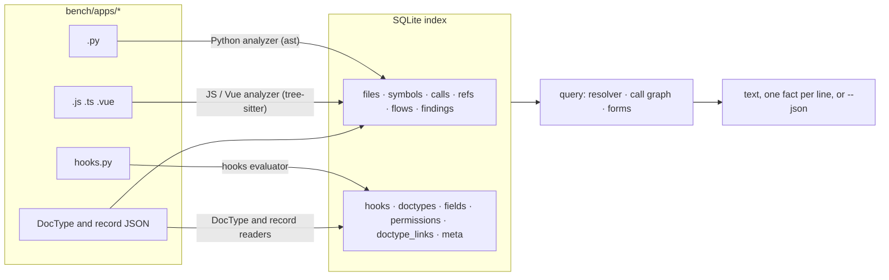

## 1. Finding the bench

Every command starts by finding the bench: `--bench`, or the nearest folder above the current
directory that holds both `apps/` and `sites/`. Each app is a folder under `apps/` with a
`hooks.py`. The index lives at `~/.cache/frappe-ast/<bench>-<hash>.sqlite` unless `--db` names
another file.

## 2. Building and refreshing the index

Every command except `outline`, `status` and `index` itself refreshes the index before it
answers; `--no-refresh` skips that.

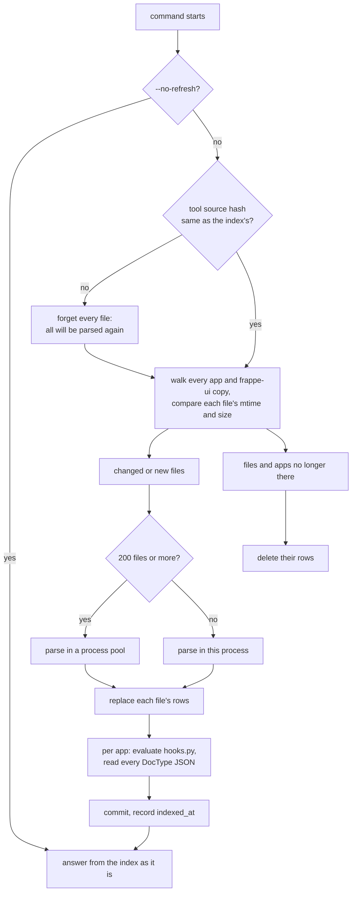

An analyzer reads one file and nothing else, which is what lets a refresh reparse only what
changed:

- **Python** (stdlib `ast`): symbols with signatures and decorators (`@frappe.whitelist`,
  `allow_guest`, `methods`), calls resolved through the file's imports, what each call is made
  on (an instance, a document of a named DocType), references the Frappe APIs make (DocTypes,
  dotted method paths, realtime events, custom fields, monkey patches), argument flow, and
  per-file check findings. Syntax newer than the running Python is rewritten first.
- **JS, TS, Vue** (tree-sitter): symbols, `frappe.call` / `frm.call` / frappe-ui targets, form
  events, fields named next to a DocType, components and their props, emits and slots.
- **Records:** a Report, Page, Web Form, Print Format, Number Card, ... JSON becomes one symbol,
  with references to the DocTypes and fields it names.
- **hooks.py** is evaluated without importing it: module-level names, `tuple()` / `list()`, `+`
  and subscript assignment are folded, so a key built in a loop still lists every entry.

The first run parses everything (seconds to a minute, depending on the bench); later runs
usually take under a second. A schema change (`SCHEMA_VERSION`) rebuilds the tables.

## 3. What the index holds

| Table | One row per | Filled by |
|---|---|---|
| `files` | indexed file: path, app, language, parse error | indexer |
| `symbols` | function, method, class, variable, component, record | analyzers |
| `calls` | call site: caller, callee as written, resolved target, what it is called on, first literal argument | Python and JS analyzers |
| `refs` | reference a Frappe API makes: DocType, dotted method, form event, field, import, callback, patch, ... | analyzers |
| `flows` | (call, argument, source) inside one function | Python analyzer |
| `findings` | per-file check finding | analyzers |
| `hooks` | `hooks.py` entry, with up to three keys of nesting | hooks evaluator |
| `doctypes`, `fields`, `permissions`, `doctype_links` | DocType, field, permission row, connection / action / state | DocType reader |
| `meta` | schema version, tool hash, bench path, frappe-ui copies, frontends | indexer |

Analyzers record only what one file says. Joining facts across files and apps is the job of the
queries.

## 4. What the queries share

- **Resolver.** Turns a dotted path into a symbol, following re-exports (`from .api import run`
  in a package `__init__`); finds a DocType's controller class next to its JSON; looks a method
  up on a class and its bases, including bases in other apps.
- **Call graph.** Turns `calls` rows and references into typed edges: plain calls, inherited
  and overriding methods, instances, document methods, the document lifecycle, `doc_events`,
  hook dispatch, typed module attributes, callbacks and dotted strings.
- **Form resolution.** Works out which desk form a piece of JS runs on: the DocType folder,
  `doctype_js` hooks, `frappe.ui.form.on`, and for shared code, the forms that call it or
  install its class.
- **Rendering.** Text output puts one fact per line, `path:line` first, and leaves out empty
  sections; `--limit` caps each section. `--json` prints the full result unchanged.

## 5. Command by command

### `index`

Runs the refresh in section 2 and prints how many files it parsed, removed and kept.

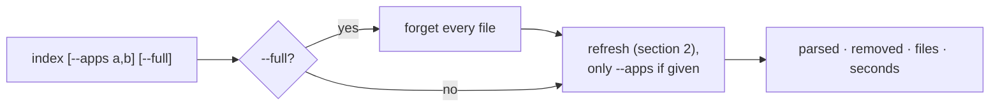

### `status`

Reads the index without refreshing it.

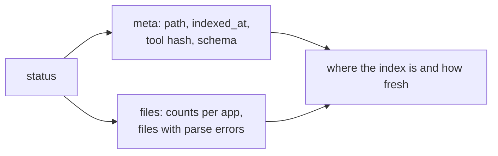

### `outline`

Parses one file straight from disk; the index is not used.

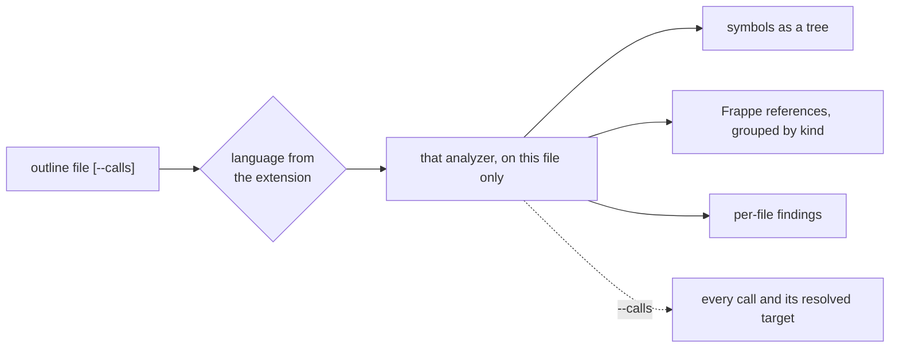

### `find`

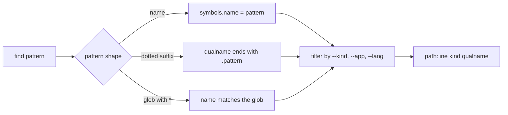

### `callers`

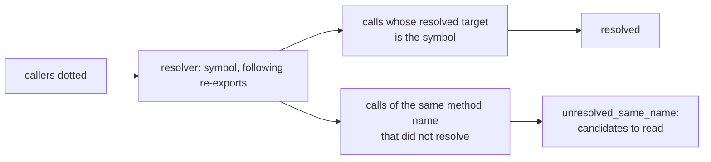

### `callees`

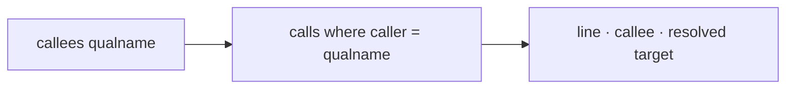

### `refs`

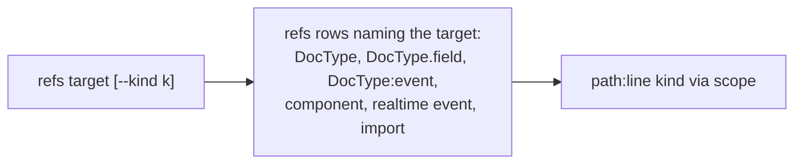

### `sql`

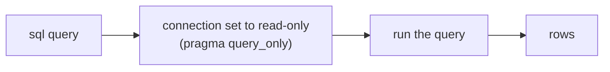

### `method`

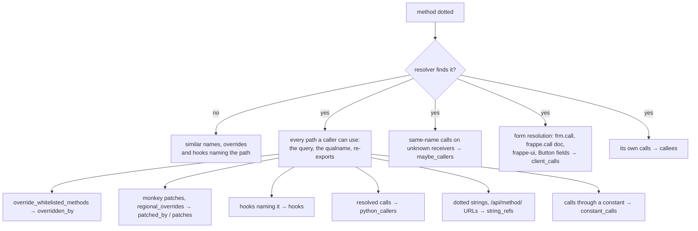

### `doctype`

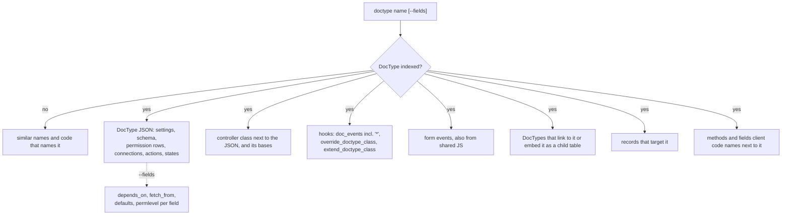

### `form`

The order follows desk itself: `frappe/desk/form/meta.py` for scripts and
`frappe/public/js/frappe/form/script_manager.js` for handlers.

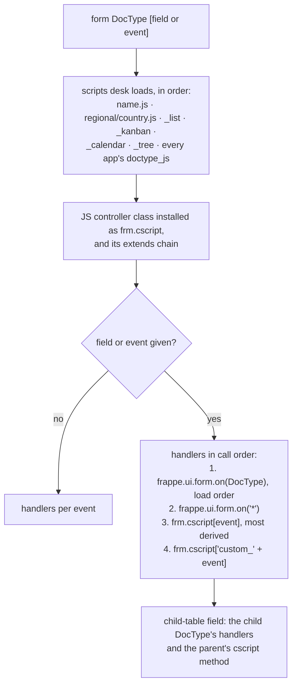

### `record`

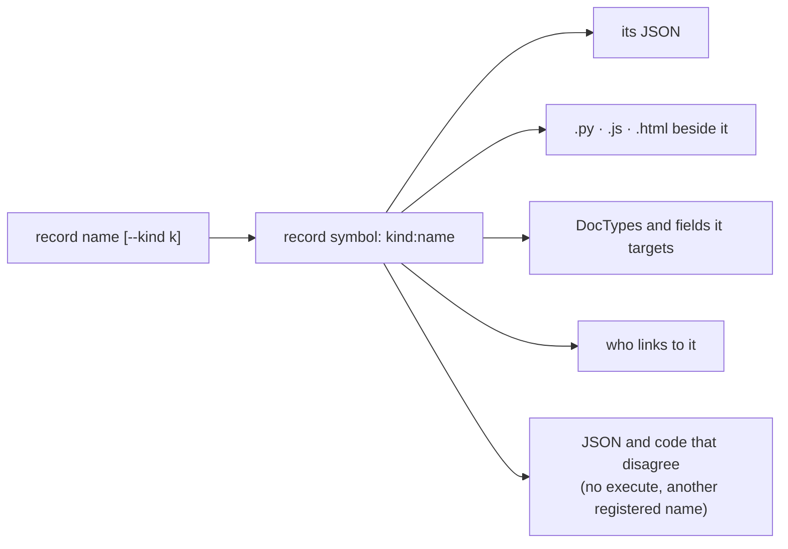

### `endpoints`

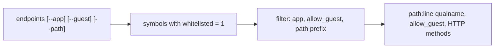

### `hooks`

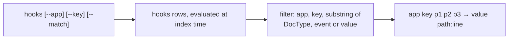

### `component`

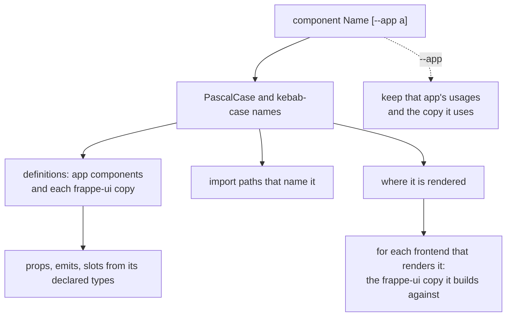

### `apps`

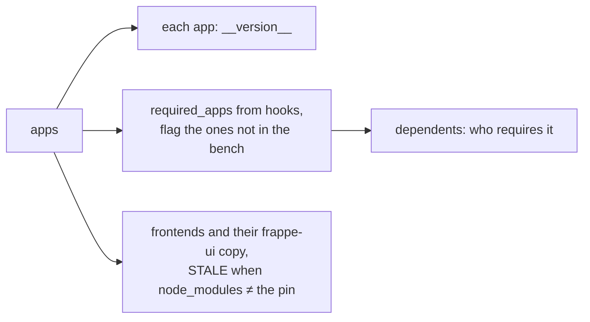

### `edges`

[Guide](call-graph.md#edges-what-a-function-makes-run).

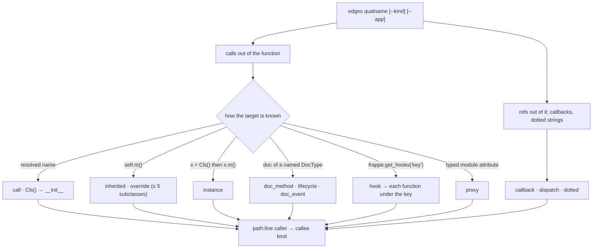

### `paths`

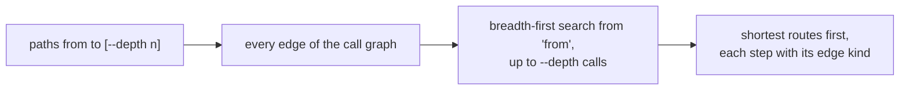

### `surface`

[Guide](call-graph.md#surface-entry-points).

```mermaid
flowchart TD
  a["surface [--kind k] [--reached]"] --> roots["entry points with their kinds"]
  s1["@frappe.whitelist → api / guest_api"] --> roots
  s2["werkzeug Rule endpoint → route"] --> roots
  s3["frappe.app.application, request hooks → request"] --> roots
  s4["get_context in www/, pages, web forms → www"] --> roots
  s5["controller lifecycle method → doc_lifecycle"] --> roots
  s6["report execute → report"] --> roots
  s7["hooks.py values → doc_event, permission,<br/>scheduler, template, hook"] --> roots
  roots --> r{"--reached?"}
  r -->|no| out["function and its kinds"]
  r -->|yes| bfs["walk the call graph from all of them at once"] --> out2["every function reached:<br/>fewest calls from any entry point,<br/>every kind that gets there"]
```

### `reach`

```mermaid
flowchart LR
  a["reach qualname [--depth n]"] --> back["walk edges backwards<br/>from the function"]
  back --> hit{"an entry point?"}
  hit -->|yes| route["record the route, one per entry point"]
  hit -->|no| back
  route --> out["root and kinds, then each step<br/>path:line caller -kind-> callee"]
```

### `flow`

[Guide](argument-flow.md).

```mermaid
flowchart TD
  a["flow qualname [--to] [--source] [--direct] [--follow]"] --> rows["flows rows of the function<br/>(recorded at index time)"]
  rows --> f{"--follow?"}
  f -->|no| filt["filter: --to, --source, --direct"] --> out["path:line caller source callee arg via"]
  f -->|yes| bind["argument → parameter of each callee the call graph resolves<br/>(position, keyword, *args, **kwargs, self skipped)"]
  bind --> inner["that function's flows from the parameter"]
  inner --> depth{"--depth reached?"}
  depth -->|no| bind
  depth -->|yes| out2["rows with the original source,<br/>via from every function, and 'through'"]
  inner --> out2
```

How a single function's flows are recorded at index time:

```mermaid
flowchart LR
  p["parameters, form_dict,<br/>request parts"] --> env["what each local name holds"]
  env -->|"assignment: replace<br/>branch, loop: add"| env
  env --> args["each call's arguments"]
  args --> row["flows row: source, arg,<br/>via (steps, outermost first)"]
```

### `check`

```mermaid
flowchart TD
  a["check [path] [--rule ids] [--no-cross]"] --> file["per-file findings stored at index time (FA1xx)"]
  a --> cross{"--no-cross?"}
  cross -->|no| x["cross-file rules over the index (FX2xx)"]
  x --> x1["hooks.py paths that do not resolve"]
  x --> x2["client calls to missing or not whitelisted methods"]
  x --> x3["DocType methods and fields client code names but the DocType lacks"]
  x --> x4["form handlers for names that are no field or event"]
  x --> x5["required_apps not in the bench"]
  x --> x6["records whose JSON and code disagree"]
  x --> x7["patches on functions that no longer exist"]
  file --> f["filter: path, --rule"] --> out["path:line rule severity message"]
  x1 --> f
  x2 --> f
  x3 --> f
  x4 --> f
  x5 --> f
  x6 --> f
  x7 --> f
```

`--list-rules` prints each rule's id and meaning.

### `impact`

```mermaid
flowchart TD
  a["impact [--base ref] [--apps a,b]"] --> diff["git diff -U0 base in each app<br/>(uncommitted work vs HEAD by default)"]
  diff --> lines["changed lines per file"]
  lines --> sym["innermost symbol around each line"]
  sym --> exp["whitelisted? → exposure"]
  sym --> c["resolved callers, under every re-export path"]
  sym --> h["hooks naming it"]
  sym --> s["dotted strings and URLs naming it"]
  sym --> p["patches that replace it"]
```

Untracked files are not part of the diff.

## 6. What it does not do

frappe-ast never imports or runs app code, and needs no site or database. That keeps it safe to
run anywhere and on any bench version, and it is also its limit: values only known at run time,
site data (Custom Fields, Client Scripts, Property Setters, Custom DocPerm rows) and calls
through names built at run time are outside what it can see.
[`harness/AGENTS.md`](../harness/AGENTS.md#what-static-analysis-cannot-see) keeps the full list.
